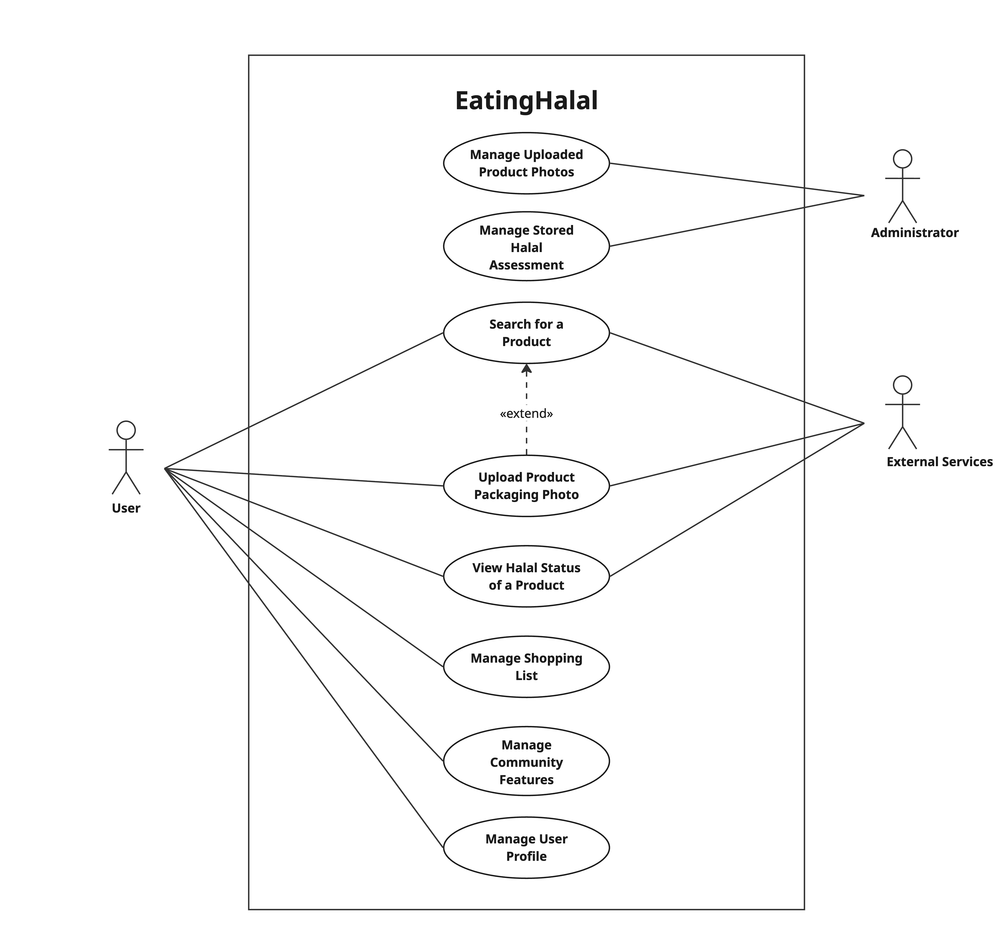
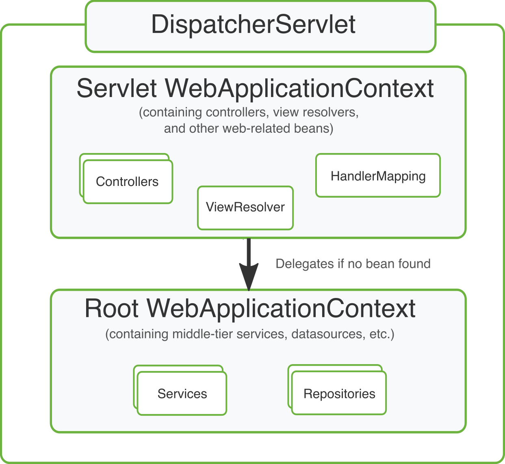
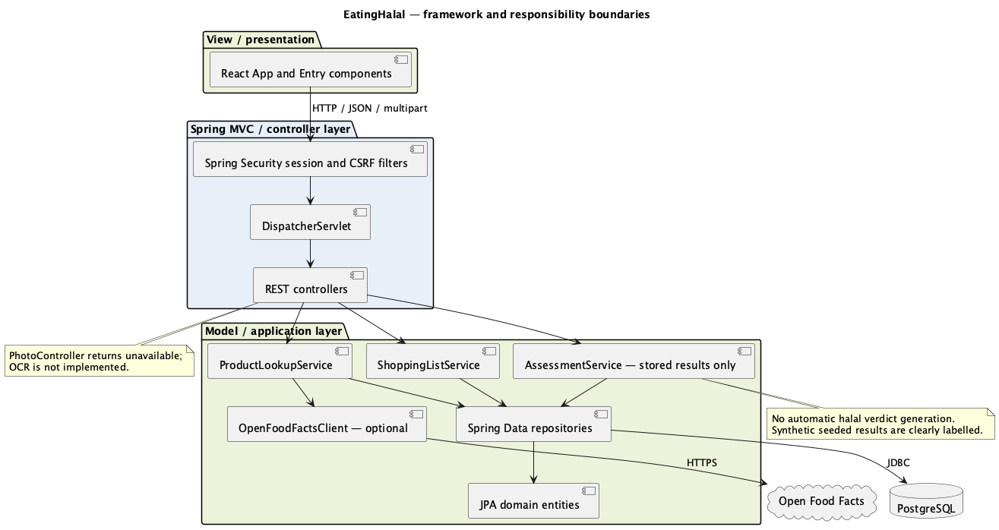
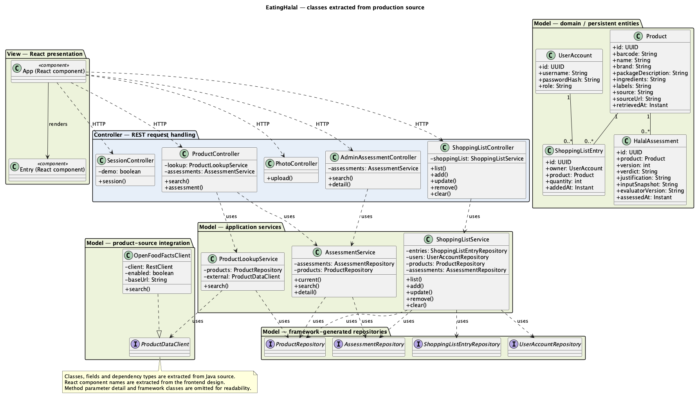
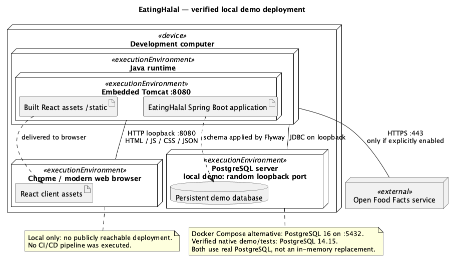
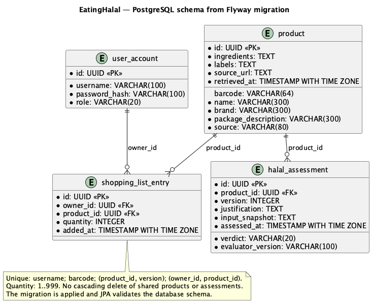

# Software Architecture Document: EatingHalal

## Table of Contents

- [1. Introduction](#1-introduction)
- [2. Architectural Representation](#2-architectural-representation)
- [3. Architectural Goals and Constraints](#3-architectural-goals-and-constraints)
- [4. Use-Case View](#4-use-case-view)
- [5. Logical View](#5-logical-view)
- [6. Process View](#6-process-view)
- [7. Deployment View](#7-deployment-view)
- [8. Implementation View](#8-implementation-view)
- [9. Data View](#9-data-view)
- [10. Size and Performance](#10-size-and-performance)
- [11. Quality](#11-quality)

## 1. Introduction

EatingHalal helps users find packaged food and review halal assessment evidence. Restaurants and freshly prepared foods are outside scope. This document describes the actual local implementation and explicitly identifies unfinished functionality. Requirements are in the [SRS](SoftwareRequirementsSpecification.md); current assignment coverage and publication gaps are in [Submission Status](SubmissionStatus.md).

Implemented: stored product search, optional Open Food Facts fallback, stored-assessment viewing, admin-only review, personal shopping-list CRUD and a React client. Not implemented: automatic halal verdict generation and OCR/product extraction. The photo endpoint returns unavailable and never pretends to generate evidence. Seeded verdicts are synthetic classroom fixtures, visibly labelled in the UI.

## 2. Architectural Representation

The application is a layered client/server modular monolith. The browser runs React. Spring MVC controllers translate HTTP/JSON requests into service calls. Services enforce application rules, and Spring Data JPA repositories persist entities in PostgreSQL. Spring Security provides authenticated sessions, role checks and CSRF protection.

MVC labels identify responsibilities: React is the **View/presentation**; the REST classes are **Controllers**; domain entities, services, repositories and source integrations comprise the **Model/application layer**. React is not described as an MVC framework. Since controllers return JSON, Spring does not render the product UI through server-side templates.

## 3. Architectural Goals and Constraints

- Java 17 language target, Spring Boot 3.2.4, Maven, React and PostgreSQL. PostgreSQL was explicitly selected by the project owner.
- Separation of presentation, request handling, business rules, storage and external sources.
- Personal shopping lists survive application restart and are scoped to server-verified identity.
- Administrative assessment access requires an admin role; the public product result endpoint is separate.
- Stored results retain the evaluated input snapshot, evaluator identifier, version and assessment time. Imported provider labels alone do not authorize a confirmed verdict.
- Quantity is 1–999 and each owner/product pair is unique. Deleting a list entry does not delete shared products or assessment history.
- External API calls use an identifying User-Agent, timeout, bounded caching and a conservative search throttle. No provider credentials are sent to the browser.
- Public HTTPS and scalable capacity remain future deployment work. The [SRS performance goals](SoftwareRequirementsSpecification.md#34-performance) have not been demonstrated by a load test.

## 4. Use-Case View

[PlantUML source](assets/plantuml-code/SoftwareRequirementsSpecification-UseCases.puml) | [SRS use-case view](SoftwareRequirementsSpecification.md#22-use-case-diagram)

| Use case | Application responsibilities | Coverage |
| --- | --- | --- |
| [Product search](use-cases/UC01-search-product.md) | ProductController → ProductLookupService → ProductRepository / ProductDataClient | Local-first search and imported fallback; photo navigation is present in React. |
| [Halal-status viewing](use-cases/UC02-view-halal-status.md) | ProductController → AssessmentService → AssessmentRepository | Stored results and explicit unavailable response. New verdict generation is not implemented. |
| [Packaging photo](use-cases/UC03-upload-product-photo.md) | React upload panel → PhotoController | Availability/error response only; OCR and canonical extraction are not implemented. |
| [Stored assessment administration](use-cases/UC04-manage-stored-halal-assessment-results.md) | Security role check → AdminAssessmentController → AssessmentService | Search, list and detail review. Read-only, as specified. |
| [Shopping list](use-cases/UC05-manage-shopping-list.md) | Session identity → ShoppingListController → ShoppingListService → repositories | Add, view, quantity update, remove and clear; eligibility, duplicate and ownership rules. |

Later-phase photo administration, community and profile-management functions remain out of this week's implementation.

## 5. Logical View

### 5.1 Framework and high-level architecture

The Spring reference explains DispatcherServlet as the front controller and distinguishes controller/web infrastructure from shared services. The following framework diagram is reproduced from [Spring's Context Hierarchy documentation](https://docs.spring.io/spring-framework/reference/web/webmvc/mvc-servlet/context-hierarchy.html). It illustrates framework roles, not a claim that EatingHalal manually creates separate application contexts.

EatingHalal maps those responsibilities to the following components:

[PlantUML source](assets/plantuml-code/SAD-Architecture.puml)

### 5.2 Code-derived class diagram with MVC regions

[PlantUML source](assets/plantuml-code/SAD-ClassDiagram.puml) | [Generator](../scripts/generate-diagrams.py)

The generator reads production Java classes/interfaces, fields, public method names and dependency types. It groups them into controller and model responsibilities. React App/Entry component names are shown separately as presentation components. Configuration/bootstrap and detailed DTO parameter signatures are omitted for readability. Test-step classes are not counted as production domain entities. UML cardinalities for entity references correspond to foreign keys in the migration; they do not confer data-access permission.

The services control transactions and map entities to response records. JPA relations are eagerly fetched for this small demo to avoid returning uninitialized proxy fields. No credential-bearing entity is exposed as an API response. A full account lifecycle and production provisioning process are not implemented; local demo accounts exist only when the demo setting is enabled.

## 6. Process View

Automated deployment: **n/a at present**, following the board's section mapping. No Travis CI/CD workflow has been implemented or executed. The local build/start procedure is documented in the [Local Demo Guide](LocalDemoGuide.md). Docker Compose configures a persistent PostgreSQL service, but Docker was unavailable during this local verification, so the native PostgreSQL path was exercised instead.

## 7. Deployment View

[PlantUML source](assets/plantuml-code/SAD-Deployment.puml)

The verified demo serves the built React files and REST API from embedded Tomcat on loopback port 8080. The test/demo helper launches a real PostgreSQL 14.15 server on a random loopback port. Its data directory can be reused across application restarts. The Compose alternative specifies PostgreSQL 16 on loopback port 5432 with a persistent volume; that route was not exercised here. There is no H2/in-memory database substitution.

The owner selected local setup for now. Therefore **no publicly reachable demo exists**, despite the TASK slide's public-server wording. No hosting provider/domain has been invented. Public hosting and blog publication remain explicitly outstanding.

## 8. Implementation View

**n/a** under the assignment's section instructions. Repository navigation and executable setup are available in the [README](../README.md) and [Local Demo Guide](LocalDemoGuide.md).

## 9. Data View

[PlantUML source](assets/plantuml-code/SAD-DatabaseModel.puml) | [Flyway migration](../backend/src/main/resources/db/migration/V1__initial_schema.sql)

The EER diagram is generated from the migration actually applied to PostgreSQL. Hibernate validates the entity/schema mapping on startup. IDs use PostgreSQL UUID columns, times use time-zone-aware timestamps, owner/product and product/version pairs are unique, and quantity is constrained to 1–999. Shared products and assessments are not deleted when a personal entry is removed.

[Data inventory and stewardship](DataStewardship.md) identifies purposes, access boundaries and unresolved lifecycle decisions. Stored assessments are derived products with evidence snapshots and evaluator identifiers. New evaluation remains unimplemented; the initial data uses synthetic results. OCR uploads are not retained or sent to providers.

## 10. Size and Performance

Optional under the assignment. Query results are bounded, provider searches are throttled and cached, and external calls time out. Those measures are not proof of the [SRS capacity/latency targets](SoftwareRequirementsSpecification.md#34-performance). Concurrent-load measurements and service-level availability are outstanding.

## 11. Quality

Optional under the assignment. Real API acceptance tests use RestAssured, Cucumber/JUnit and an isolated PostgreSQL server; no database is mocked. A controlled HTTP provider fixture tests adapter mapping, persistence and User-Agent handling. Browser checks exercise React CRUD, identity isolation, admin review, photo-navigation limitations and a mobile viewport. Evidence and exact exclusions are in the [Submission Status](SubmissionStatus.md).

The remaining OCR/new-assessment scenarios are tagged pending rather than supported by boolean simulations. See the [human contribution record](HumanContribution.md) and [prepared AI experiment](AIArchitectureExperiment.md). A historical passing skeleton report is not used as proof of application functionality.
