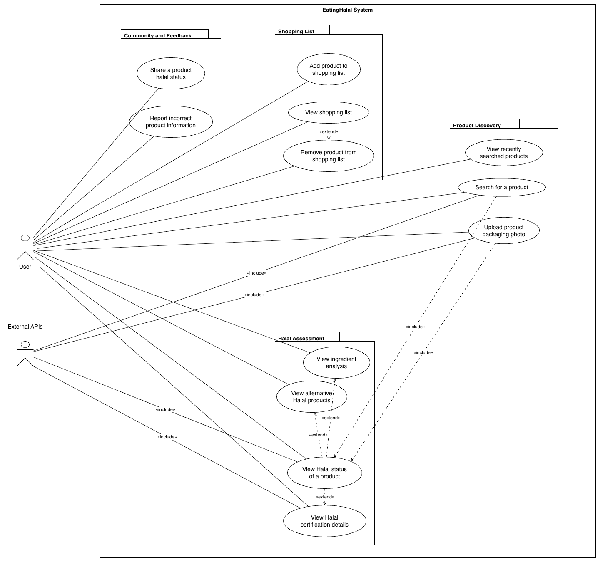

# EatingHalal- Software Requirements Specification 

## Table of contents
- [Table of contents](#table-of-contents)
- [Introduction](#1-introduction)
    - [Purpose](#11-purpose)
    - [Scope](#12-scope)
    - [Definitions, Acronyms and Abbreviations](#13-definitions-acronyms-and-abbreviations)
    - [References](#14-references)
    - [Overview](#15-overview)
- [Overall Description](#2-overall-description)
    - [Vision](#21-vision)
    - [Use Case Diagram](#22-use-case-diagram)
	- [Technology Stack](#23-technology-stack)
- [Specific Requirements](#3-specific-requirements)
    - [Functionality](#31-functionality)
    - [Usability](#32-usability)
    - [Reliability](#33-reliability)
    - [Performance](#34-performance)
    - [Supportability](#35-supportability)
    - [Design Constraints](#36-design-constraints)
    - [Online User Documentation and Help System Requirements](#37-on-line-user-documentation-and-help-system-requirements)
    - [Purchased Components](#purchased-components)
    - [Interfaces](#39-interfaces)
    - [Licensing Requirements](#310-licensing-requirements)
    - [Legal, Copyright And Other Notices](#311-legal-copyright-and-other-notices)
    - [Applicable Standards](#312-applicable-standards)
- [Supporting Information](#4-supporting-information)

## 1. Introduction

### 1.1 Purpose
This Software Requirements Specification (SRS) describes all specifications for the application "EatingHalal". It includes an overview of this project and its vision, detailed information about the planned features, and the boundary conditions of the development process.

### 1.2 Scope
EatingHalal is a web application that helps users determine whether packaged food products comply with Islamic dietary laws. Halal is defined as food that is permissible, lawful, and clean according to Islamic dietary guidelines.

The application is scoped exclusively to **packaged food products** — restaurants and freshly prepared foods are out of scope.

Actors of this application are:
- **Users** — individuals seeking halal product information
- **Admins** — authorised users who manage stored halal assessment results
- **External Services** — third-party product-data APIs and OCR/LLM services used to process product information

Planned subsystems are:
* **Product Lookup:**
  Users can search for a product or upload a photo of its packaging when no matching product is found.
* **Halal Assessment:**
  The system normalises product information from external APIs or OCR processing, evaluates the product, and displays a halal status with supporting rationale.
* **Assessment Administration:**
  Admins can search, review, and manage stored halal assessment results.
* **Shopping List:**
  Users can maintain a personal saved list of halal-approved products for reference during shopping.
* **Later-Phase Features:**
  Admins will manage uploaded product photos, while users will manage community features and their user profiles.

### 1.3 Definitions, Acronyms and Abbreviations
| Abbreviation | Explanation                         |
| ------------ | ----------------------------------- |
| SRS          | Software Requirements Specification |
| UC           | Use Case                            |
| UCD          | Overall Use Case Diagram            |
| n/a          | not applicable                      |
| tbd          | to be determined                    |
| API          | Application Programming Interface   |
| FAQ          | Frequently Asked Questions          |

### 1.4 References

| Title                                                                                          | Date       | Publishing organization |
| -----------------------------------------------------------------------------------------------|:----------:| ----------------------- |
| [EatingHalal Blog](https://eatinghalal2.wordpress.com)                                         | 01.10.2026 | EatingHalal Team        |
| [GitHub](https://github.com/tameemraihan/EatingHalal)                                          | 01.10.2026 | EatingHalal Team        |

### 1.5 Overview
The following chapter provides an overall description of this project including its vision and Use Case Diagram. The third chapter delivers specific requirements covering functionality, usability, reliability, performance, and design constraints. The final chapter contains supporting information.
    
## 2. Overall Description

### 2.1 Vision
A world where no one has to wonder if their food is halal.

### 2.2 Use Case Diagram

The use case diagram is maintained as PlantUML source in [`EatingHalal_UseCases.puml`](./EatingHalal_UseCases.puml).

#### Actors
- **User** (Application User)
- **Admin** (Authorised Assessment Administrator)
- **External Services** (Product data APIs, OCR, and LLM services)

#### Use Cases

| # | Use Case |
|---|----------|
| UC01 | Search for a Product — User — This semester |
| UC02 | View Halal Status of a Product — User — This semester |
| UC03 | Upload Product Packaging Photo — User — This semester |
| UC04 | Manage Stored Halal Assessment Results — Admin — This semester |
| UC05 | Manage Shopping List — User — This semester |
| UC06 | Manage Uploaded Product Photos — Admin — Later phase |
| UC07 | Manage Community Features — User — Later phase |
| UC08 | Manage User Profile — User — Later phase |

### 2.3 Technology Stack
The technology we use is:

Backend:
- Maven and Spring boot
- MariaDB

Frontend:
- React

IDE:
-IntelliJ

Project Management:
- YouTrack

Deployment:
-Travis CI
-Docker

Testing:
-Cucumber
-Espresso
-JUnit
-Codacy
-CodeMR
-RestAssured

## 3. Specific Requirements

### 3.1 Functionality

This section describes the eight use cases shown in the Use Case Diagram and their functionality.

**This semester**, the team will implement UC01 through UC05:

#### 3.1.1 UC01 — Search for a Product

The user searches for a packaged food product by entering its name. The system searches the hosted product database and available external product data sources, combines matching results, and presents them to the user. When no match is found, the user can continue with photo upload.

[RUP specification](./use-cases/rup/UC01-search-product.rup.md)

#### 3.1.2 UC02 — View Halal Status of a Product

Once a product is available, the system checks for a stored assessment. If none exists, it normalises the available product data and runs the halal assessment pipeline. The user is shown a verdict — Halal, Haram, or Mashbooh — with a plain-language justification.

[RUP specification](./use-cases/rup/UC02-view-halal-status.rup.md)

#### 3.1.3 UC03 — Upload Product Packaging Photo

When no matching product is found, the user can upload a product-packaging photo. The system validates the file and uses OCR and image analysis to extract and structure product information for the halal assessment pipeline.

[RUP specification](./use-cases/rup/UC03-upload-product-photo.rup.md)

#### 3.1.4 UC04 — Manage Stored Halal Assessment Results

An authorised Admin searches, filters, reviews, and opens stored halal assessment results. The Admin can view the associated product details, halal status, and justification.

[RUP specification](./use-cases/rup/UC04-manage-stored-halal-assessment-results.rup.md)

#### 3.1.5 UC05 — Manage Shopping List

The user maintains a personal shopping list by saving products for future reference and removing products that are no longer needed. The list helps users retain products they intend to purchase or revisit.

**Later phase** use cases are planned but are outside this semester's implementation scope:

#### 3.1.6 UC06 — Manage Uploaded Product Photos

An Admin manages uploaded product photos and their processing status. This includes reviewing submitted photos and handling photos that cannot be processed reliably.

#### 3.1.7 UC07 — Manage Community Features

The user shares product information and reports incorrect product information through community features.

#### 3.1.8 UC08 — Manage User Profile

The user manages account details and application preferences. This use case is planned for a later phase.

### 3.2 Usability
We plan on designing the user interface as intuitive and self-explanatory as possible so that any user can determine the halal status of a product without prior training or technical knowledge.

#### 3.2.1 No training time needed
Our goal is that a user opens the web application and can use the current-semester features without explanation or help. Product search, photo upload, halal-status viewing, and shopping-list management should all be immediately understandable.

#### 3.2.2 Familiar Feeling
We want to implement a web app with familiar designs and interactions. Users should be able to navigate the application using patterns they already know from other product lookup or food apps.

### 3.3 Reliability

#### 3.3.1 Availability
The server shall be available 95% of the time. Any planned downtime should be scheduled during off-peak hours to minimize disruption to users.

#### 3.3.2 Defect Rate
Our goal is to have no loss of user data. Shopping lists and stored halal assessment results must be preserved across sessions, even after a server restart or downtime.

### 3.4 Performance

#### 3.4.1 Capacity
The system should be able to handle thousands of concurrent requests. It should also be able to support an unrestricted number of users simultaneously searching for products.

#### 3.4.2 Response Time
Product lookup results should be returned within 3 seconds under normal load. Photo upload and OCR analysis may take longer but should complete within 10 seconds.

### 3.5 Supportability

#### 3.5.1 Coding Standards
We will write code following common clean code standards. Variables, methods, and components will be named clearly by their function. This will keep the codebase readable and make further development easier.

#### 3.5.2 Testing Strategy
The application will have high test coverage. All critical functionality — including halal assessment logic, API integrations, OCR processing, stored-assessment management, and shopping-list operations — must be covered by unit and integration tests. Bugs should be discoverable and locatable quickly through automated testing.

### 3.6 Design Constraints
We are aiming for a modern, clean, and responsive web design. Functionality will be kept modular to allow independent development of frontend and backend.

The technology stack is:
- **Backend:** Java Spring Boot with a RESTful API serving data in JSON format
- **Frontend:** ReactJS
- **Communication:** HTTP/HTTPS protocol between frontend and backend

Supported platforms:
- Any modern web browser (Chrome, Firefox, Safari, Edge)
- Desktop and mobile browsers

### 3.7 Online User Documentation and Help System Requirements
The usage of the application should be as intuitive as possible so it will not need extensive documentation. If the user needs help, a FAQ section will be available within the application covering common questions about halal-status verdicts, product-photo upload, and shopping-list management. Community reporting guidance will be added in the later phase.

### 3.8 Purchased Components
We don't have any purchased components yet. External APIs used for product and ingredient data may require paid tiers as usage scales; these will be listed here when confirmed.

### 3.9 Interfaces

#### 3.9.1 User Interfaces
The user interfaces to be implemented are:
- **Home / Search Page** — allows users to search for a product by name
- **Search Results Page** — displays matching products returned from hosted and external data sources
- **Photo Upload Page** — allows users to upload a product packaging photo for OCR-based analysis
- **Halal Assessment Page** — displays the halal verdict and supporting justification for a product
- **Stored Assessments Page** — allows authorised Admins to search, filter, and review stored assessment results
- **Shopping List Page** — displays all products saved by the user with their halal verdicts
- **Uploaded Photo Management Page** *(later phase)* — allows Admins to manage uploaded product photos
- **Community Features Page** *(later phase)* — supports sharing and reporting product information
- **User Profile Page** *(later phase)* — allows users to manage account details and preferences

#### 3.9.2 Hardware Interfaces
(n/a)

#### 3.9.3 Software Interfaces
The application will be accessible via any modern web browser. The backend exposes a RESTful API consumed by the ReactJS frontend. External services are integrated server-side for product data and OCR/LLM processing.

#### 3.9.4 Communication Interfaces
The frontend and backend communicate over HTTPS. External API calls are made server-side over HTTPS.

### 3.10 Licensing Requirements
(to be determined)

### 3.11 Legal, Copyright, and Other Notices
We do not take responsibility for any incorrect halal verdicts resulting from inaccurate or outdated data provided by external APIs. Community reporting of incorrect information is planned for a later phase.

### 3.12 Applicable Standards
The development will follow common clean code standards and naming conventions. A definition of done will be established and added here once finalized.

## 4. Supporting Information
For any further information you can contact the EatingHalal team or check our [EatingHalal Blog](https://eatinghalal2.wordpress.com).

The team members are:
- Tamim
- Taha
- Benjamin
