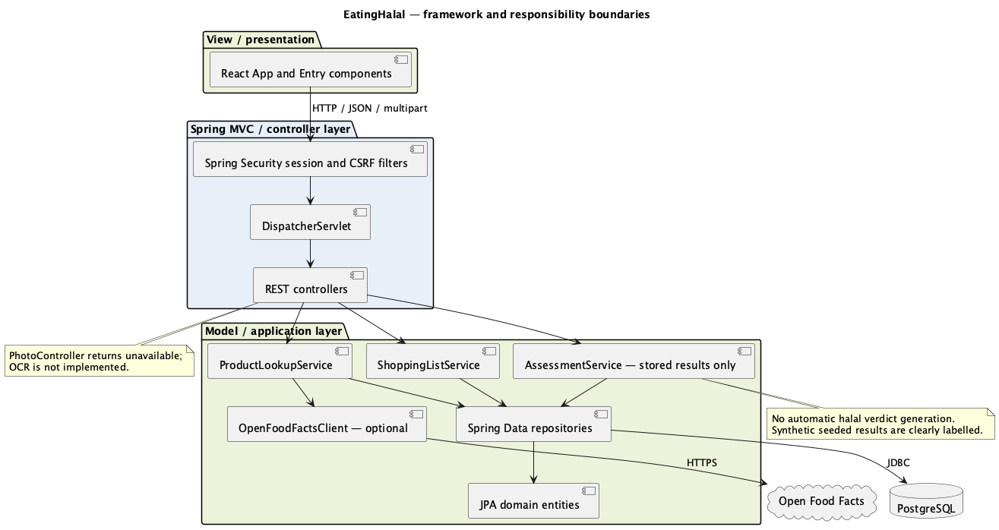
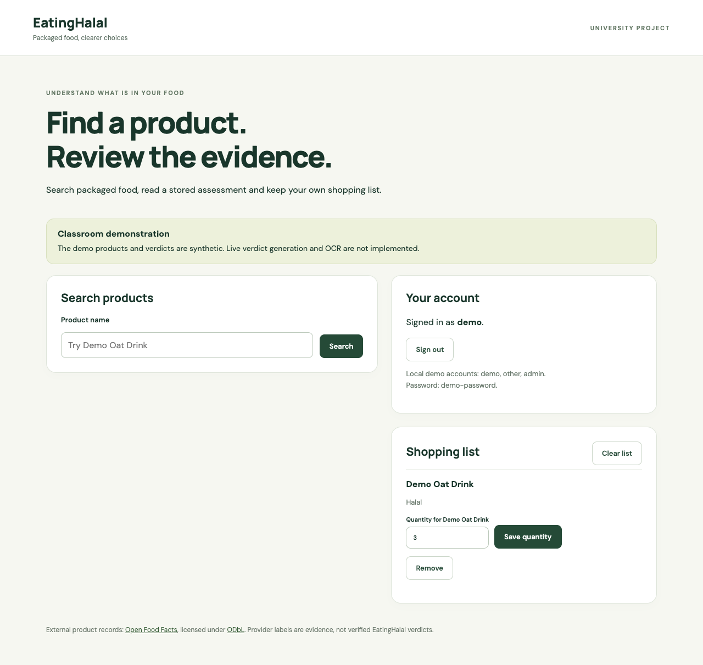

# Draft for team review — publication outstanding

## 8. Software Architecture: Connecting Our Design to Working Code

This week, EatingHalal continued the Elaboration phase by connecting the architecture lecture to a working application slice. The focus was separation of responsibilities, framework conventions and diagrams that describe the code we actually have. Our earlier specifications provided the starting point; the implementation now connects product search, stored assessments and shopping lists to a real PostgreSQL database.

## Our Framework and Architectural Boundaries

We use Java 17, Spring Boot and Spring MVC for the backend, with React for presentation. Controllers receive HTTP requests and return JSON, services coordinate business rules, and Spring Data JPA repositories handle persistence. PostgreSQL is our chosen database. The browser presents data and actions, while ownership and eligibility decisions are enforced on the server.

The following diagram shows how these responsibilities fit together.

Spring supplies application configuration, request mapping, repository implementations and security infrastructure. It does not generate a complete user interface or decide domain rules. Our [Software Architecture Document](https://github.com/tameemraihan/EatingHalal/blob/EH-60/docs/architecture/SoftwareArchitectureDocument.md) distinguishes the framework's contribution from the controller, service and React code implemented for EatingHalal.

## A Complete CRUD Slice

The personal shopping list demonstrates Create, Read, Update and Delete. A signed-in user adds a product with a stored Halal assessment, views the list, edits its quantity and removes it. Quantity editing was added to the specification and activity diagram so Update is explicit. Duplicate products and invalid quantities are rejected, and another user cannot modify the original user's entry.

This screenshot shows the local demonstration using synthetic product evidence.

The demo verdicts are classroom fixtures, not real dietary assessments. We implemented optional [Open Food Facts](https://openfoodfacts.github.io/openfoodfacts-server/api/) lookup when no stored product matches. The adapter records provenance, identifies the application, applies timeouts and limits repeated searches. Imported ingredient or certification labels remain evidence; they do not automatically become a confirmed EatingHalal verdict.

## Testing the Application Rather Than Scenario State

An issue in the earlier setup was that step definitions changed booleans and maps inside the tests. Passing those scenarios showed that Cucumber infrastructure worked, but did not demonstrate functioning API routes or persistence. The implemented scenarios now call HTTP endpoints through RestAssured and verify records in a real, isolated PostgreSQL instance.

The suite executes twenty implemented scenarios, with six unavailable flows explicitly pending. Browser checks cover the integrated React workflow and a mobile viewport. A separate restart check verifies that the same shopping-list entry and quantity survive a complete application and database restart. The [submission status](https://github.com/tameemraihan/EatingHalal/blob/EH-60/docs/submissions/week-08/README.md) links recordings and reports and names the exclusions.

## Keeping the Architecture Document Current

The class diagram is generated from production source and grouped by architectural responsibility. The database diagram comes from the Flyway migration, and the UML deployment view shows the local setup. We document an assessment's input snapshot, evaluator identifier and version as provenance for a derived result. These diagrams explain the implementation; they do not imply that unfinished OCR or verdict generation already exists.

## What's Next

OCR, canonical extraction and automatic assessment generation remain unimplemented. The next work requires selecting provider integrations and validating assessment criteria. Hosting stays local for now, so a publicly reachable demo and online publication still need attention before claiming every requirement is satisfied. The comparative AI experiment is prepared as a brief, with no measured result claimed.

---

**Publication declaration — team review is pending; use the declaration below only after that review.**

*This post was drafted with the assistance of an AI language model. All project decisions, implementations, and content reflect the authentic work of the EatingHalal team. The team reviewed and is responsible for all published content.*
