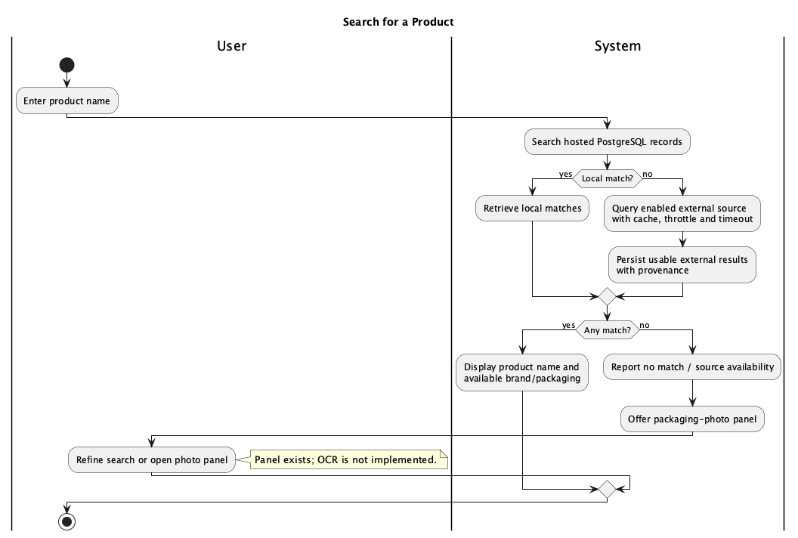

# Use-Case Specification: Search for a Product

## Table of Contents

- [1. Brief Description](#1-brief-description)
- [2. Flow of Events](#2-flow-of-events)
  - [2.1 Basic Flow](#21-basic-flow)
  - [2.2 Alternative Flows](#22-alternative-flows)
    - [2.2.1 No Matching Product Found](#221-no-matching-product-found)
  - [Activity Diagram](#activity-diagram)
- [3. Special Requirements](#3-special-requirements)
  - [3.1 Search Results](#31-search-results)
  - [3.2 Response Time](#32-response-time)
  - [3.3 Usability](#33-usability)
  - [3.4 Interfaces and Availability](#34-interfaces-and-availability)
- [4. Preconditions](#4-preconditions)
- [5. Postconditions](#5-postconditions)
- [6. Extension Points](#6-extension-points)
  - [6.1 Product Search Completed](#61-product-search-completed)

> Implementation status: Implemented: local-first search and optional external fallback. Packaging-panel navigation exists; its Cucumber scenario remains pending and browser-tested separately. See [the project README](../../README.md#implementation-status).

## 1. Brief Description

A **User** searches for a packaged food product by entering its name. The system searches the hosted product database first and queries an enabled external product data source when there is no local match, then presents matching products. When no match is found, the user can start [Upload Product Packaging Photo (UC03)](UC03-upload-product-photo.md) or refine the search.

**Primary actor:** User 
**Supporting actors:** External product data sources 
**Trigger:** The user wants to find a packaged food product.

## 2. Flow of Events

### 2.1 Basic Flow

1. The user enters a product name.
2. The system searches the hosted product database for products matching the entered name.
3. If the hosted database has no match, the system queries an enabled external product data source, respecting its rate limits.
4. The system retrieves local matches or persists and retrieves usable external results with source attribution.
5. The system determines whether any matching products were found.
6. The system presents the matching products to the user.
7. The use case ends.

### 2.2 Alternative Flows

#### 2.2.1 No Matching Product Found

At [step 5 of the basic flow](#21-basic-flow), no matching product is found.

1. The system informs the user that no matching product was found.
2. The system offers the user the option to upload a photo of the product packaging.
3. The user chooses whether to start [Upload Product Packaging Photo (UC03)](UC03-upload-product-photo.md).
4. If the user chooses to upload a photo, the system starts [UC03](UC03-upload-product-photo.md).
5. Otherwise, the user refines the product name or ends the search.

### Activity Diagram

[PlantUML source](../assets/plantuml-code/UC01-search-product.puml) | [Cucumber feature](../../backend/src/test/resources/features/uc01_search_product.feature)

## 3. Special Requirements

### 3.1 Search Results

The system shall present enough product information for the user to distinguish between matching products, including the product name and any available manufacturer or package information.

### 3.2 Response Time

Under normal load, the system should return product search results within 3 seconds.

### 3.3 Usability

The product-search and search-results screens shall be understandable without prior training. The user shall be able to refine a search after no matching product is found.

### 3.4 Interfaces and Availability

The web application communicates with its backend and external data sources using the Hypertext Transfer Protocol (HTTP) and Hypertext Transfer Protocol Secure (HTTPS). The system shall not present unavailable external data as a confirmed product match. Open Food Facts is the initial external adapter; it can be disabled for local demos. A source outage or rate limit shall be reported without inventing results.

## 4. Preconditions

1. The EatingHalal web application is available to the user.
2. The user has a product name to search for.
3. The hosted product database or at least one product data source is available.

## 5. Postconditions

1. Matching products have been presented to the user, or the user has been informed that no match was found.
2. When no match is found and the user chooses to upload a photo, [Upload Product Packaging Photo (UC03)](UC03-upload-product-photo.md) has been started.

## 6. Extension Points

### 6.1 Product Search Completed

When no matching product is found, the user may continue to a related use case:

- [Upload Product Packaging Photo (UC03)](UC03-upload-product-photo.md)
