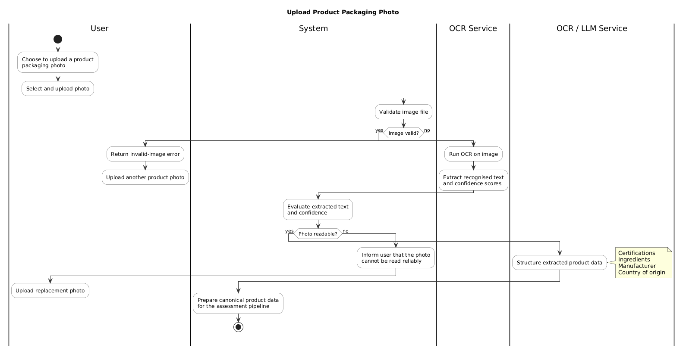

# Use-Case Specification: Upload Product Packaging Photo

## Table of Contents

1. [Brief Description](#1-brief-description)
2. [Flow of Events](#2-flow-of-events)
   - [2.1 Basic Flow](#21-basic-flow)
   - [2.2 Alternative Flows](#22-alternative-flows)
     - [2.2.1 Invalid Image File](#221-invalid-image-file)
     - [2.2.2 Unreadable Photo](#222-unreadable-photo)
     - [2.2.3 Insufficient Product Information](#223-insufficient-product-information)
   - [Activity Diagram](#activity-diagram)
3. [Special Requirements](#3-special-requirements)
   - [3.1 Image Validation](#31-image-validation)
   - [3.2 Product Information](#32-product-information)
   - [3.3 Response Time](#33-response-time)
   - [3.4 Usability](#34-usability)
   - [3.5 Interfaces and Availability](#35-interfaces-and-availability)
4. [Preconditions](#4-preconditions)
5. [Postconditions](#5-postconditions)
6. [Extension Points](#6-extension-points)
   - [6.1 Structured Product Data Prepared](#61-structured-product-data-prepared)

> Implementation status: Not implemented: OCR, image decoding/validation, confidence evaluation and canonical extraction. The UI/endpoint only report availability; all four OCR flow scenarios are pending. See [the project README](../../README.md#implementation-status).

## 1. Brief Description

A **User** uploads a photo of a packaged food product when a suitable product cannot be found through search, or when the user chooses to identify a product from its packaging. The system validates the image, uses Optical Character Recognition (OCR) to extract text, and uses an OCR/Large Language Model (LLM) service to structure the available product information. The resulting data is prepared in the canonical format required by the halal assessment pipeline.

**Primary actor:** User 
**Supporting actors:** Optical Character Recognition (OCR) Service; OCR/Large Language Model (LLM) Service 
**Trigger:** The user wants to identify a packaged product by uploading a photo of its packaging.

## 2. Flow of Events

### 2.1 Basic Flow

1. The user chooses to upload a product packaging photo.
2. The user selects and uploads a photo.
3. The system validates the image file.
4. The system sends the valid image to the OCR Service.
5. The OCR Service extracts recognised text and confidence scores from the image.
6. The system evaluates the extracted text and its confidence.
7. The OCR/LLM Service structures the available product data, including certifications, ingredients, manufacturer, and country of origin.
8. The system prepares the extracted data in the canonical product-data format used by the halal assessment pipeline.
9. The use case ends.

### 2.2 Alternative Flows

#### 2.2.1 Invalid Image File

At [step 3 of the basic flow](#21-basic-flow), the image file is invalid.

1. The system returns an invalid-image error to the user.
2. The user uploads another product photo.
3. The flow resumes at [step 3 of the basic flow](#21-basic-flow).

#### 2.2.2 Unreadable Photo

At [step 6 of the basic flow](#21-basic-flow), the extracted text has insufficient confidence and the photo is unreadable.

1. The system informs the user that the photo cannot be read reliably.
2. The system asks the user to upload another product photo.
3. The user uploads a replacement photo.
4. The flow resumes at [step 3 of the basic flow](#21-basic-flow).

#### 2.2.3 Insufficient Product Information

At [step 7 of the basic flow](#21-basic-flow), the extracted information is insufficient to prepare usable structured product data.

1. The system informs the user which essential product information could not be identified.
2. The user uploads a clearer or more complete photo of the product packaging.
3. The flow resumes at [step 3 of the basic flow](#21-basic-flow).

### Activity Diagram

[PlantUML source](../assets/plantuml-code/UC03-upload-product-photo.puml) | [Cucumber feature](../../backend/src/test/resources/features/uc03_upload_product_photo.feature)

## 3. Special Requirements

### 3.1 Image Validation

The system shall validate the uploaded file before processing it and shall reject unsupported, corrupted, or empty image files.

### 3.2 Product Information

When information is available, the structured product data shall include certifications, ingredients, manufacturer, and country of origin. Its format shall be compatible with the data structure used for products returned by external product APIs.

### 3.3 Response Time

Under normal load, image validation should complete promptly and OCR analysis should complete within 10 seconds.

### 3.4 Usability

The photo-upload, error, and product-preview screens shall be understandable without prior training. Error messages shall explain when the user needs to upload a clearer or more complete photo.

### 3.5 Interfaces and Availability

The web application communicates with the OCR and OCR/LLM services using HTTP and HTTPS. If a supporting service is unavailable, the system shall not pass unverified or incomplete extracted data to the halal assessment pipeline.

## 4. Preconditions

1. The EatingHalal web application is available to the user.
2. The user has a photo of a packaged food product to upload.
3. The OCR and OCR/LLM services are available.

## 5. Postconditions

1. A valid uploaded photo has been processed, or the user has been informed why it could not be processed.
2. When sufficient information is extracted, canonical structured product data is available for [View Halal Status of a Product (UC02)](UC02-view-halal-status.md).

## 6. Extension Points

### 6.1 Structured Product Data Prepared

After the system prepares the structured product data, the user may continue to a related use case:

- [View Halal Status of a Product (UC02)](UC02-view-halal-status.md)
