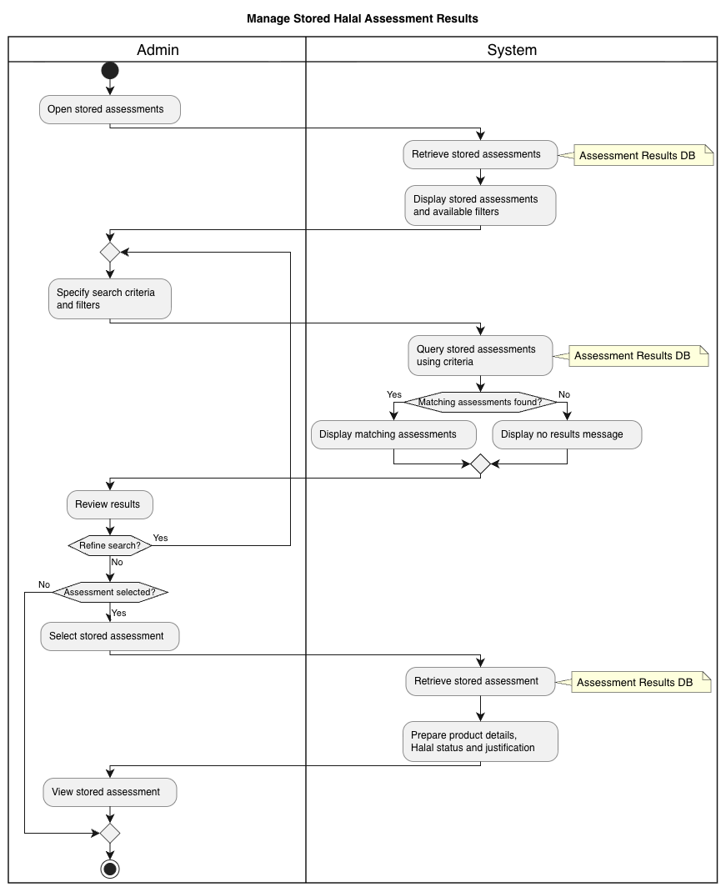

# Use-Case Specification: Manage Stored Halal Assessment Results

## Table of Contents

1. [Brief Description](#1-brief-description)
2. [Flow of Events](#2-flow-of-events)
   - [2.1 Basic Flow](#21-basic-flow)
   - [2.2 Alternative Flows](#22-alternative-flows)
     - [2.2.1 No Matching Assessments Found](#221-no-matching-assessments-found)
     - [2.2.2 Refine Search](#222-refine-search)
     - [2.2.3 No Assessment Selected](#223-no-assessment-selected)
   - [Activity Diagram](#activity-diagram)
3. [Special Requirements](#3-special-requirements)
   - [3.1 Access Control](#31-access-control)
   - [3.2 Search and Filtering](#32-search-and-filtering)
   - [3.3 Assessment Detail](#33-assessment-detail)
4. [Preconditions](#4-preconditions)
5. [Postconditions](#5-postconditions)
6. [Extension Points](#6-extension-points)
   - [6.1 Stored Assessment Displayed](#61-stored-assessment-displayed)

> Implementation status: Implemented: admin-only search, listing and detail review; read-only as specified. See [Submission Status](../SubmissionStatus.md).

## 1. Brief Description

An **Admin** manages previously stored halal assessment results. The Admin opens the stored assessments, applies search criteria and filters, reviews the matching results, and selects one assessment to view its product details, halal status, and justification. If no assessment matches the search criteria, the system informs the Admin. The Admin may refine the search and repeat the query.

**Primary actor:** Admin 
**Trigger:** The Admin needs to find and review a stored halal assessment.

## 2. Flow of Events

### 2.1 Basic Flow

1. The Admin opens the stored assessments.
2. The system retrieves the stored assessments from the assessment-results database.
3. The system displays the stored assessments and available filters.
4. The Admin specifies search criteria and filters.

5. The system queries the stored assessments using the specified criteria.
6. The system displays the matching assessments.

7. The Admin reviews the results.

8. The Admin selects a stored assessment.
9. The system retrieves the selected stored assessment from the assessment-results database.
10. The system prepares the product details, halal status, and justification.
11. The system displays the stored assessment to the Admin.
12. The use case ends.

### 2.2 Alternative Flows

#### 2.2.1 No Matching Assessments Found

At [step 5 of the basic flow](#basic-flow-step-5), no stored assessment matches the specified criteria.

1. The system displays a no-results message.
2. The Admin reviews the message.
3. The flow continues at [step 7 of the basic flow](#basic-flow-step-7).

#### 2.2.2 Refine Search

After [step 7 of the basic flow](#basic-flow-step-7), the Admin chooses to refine the search.

1. The Admin updates the search criteria and filters.
2. The flow resumes at [step 5 of the basic flow](#basic-flow-step-5).

#### 2.2.3 No Assessment Selected

After [step 7 of the basic flow](#basic-flow-step-7), the Admin does not select an assessment.

1. The system ends the use case without displaying an individual stored assessment.

### Activity Diagram

[PlantUML source](../assets/plantuml-code/UC04-manage-stored-halal-assessment-results.puml) | [Cucumber feature](../../backend/src/test/resources/features/uc04_manage_stored_halal_assessment_results.feature)

## 3. Special Requirements

### 3.1 Access Control

Only authorised Admin users shall be able to open, search, and view stored assessment results.

### 3.2 Search and Filtering

The system shall display the available filters and use the search criteria supplied by the Admin when querying stored assessments.

### 3.3 Assessment Detail

For a selected assessment, the system shall display the associated product details, halal status, and justification.

## 4. Preconditions

1. The Admin is authorised to access stored halal assessment results.
2. The assessment-results database is available.
3. At least one stored assessment may exist; if none exist or none match the criteria, the system follows the no-results flow.

## 5. Postconditions

1. The Admin has either viewed a selected stored assessment or received a no-results message.
2. No stored assessment is changed by this use case.

## 6. Extension Points

### 6.1 Stored Assessment Displayed

After the system displays a stored assessment, the Admin may continue to a related administrative use case, such as reviewing or correcting stored product information.
