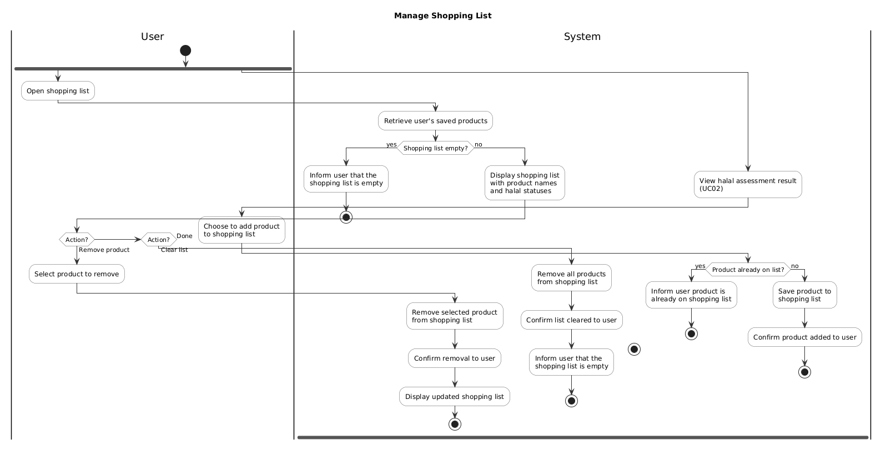

# Use-Case Specification: Manage Shopping List

## Table of Contents

1. [Brief Description](#1-brief-description)
2. [Flow of Events](#2-flow-of-events)
   - [2.1 Basic Flow](#21-basic-flow)
   - [2.2 Alternative Flows](#22-alternative-flows)
     - [2.2.1 Add Product to Shopping List](#221-add-product-to-shopping-list)
     - [2.2.2 Remove Product from Shopping List](#222-remove-product-from-shopping-list)
     - [2.2.3 Clear Shopping List](#223-clear-shopping-list)
     - [2.2.4 Shopping List Is Empty](#224-shopping-list-is-empty)
     - [2.2.5 Product Already on Shopping List](#225-product-already-on-shopping-list)
   - [Activity Diagram](#activity-diagram)
3. [Special Requirements](#3-special-requirements)
   - [3.1 List Contents](#31-list-contents)
   - [3.2 Persistence](#32-persistence)
   - [3.3 Usability](#33-usability)
   - [3.4 Interfaces and Availability](#34-interfaces-and-availability)
4. [Preconditions](#4-preconditions)
5. [Postconditions](#5-postconditions)
6. [Extension Points](#6-extension-points)
   - [6.1 Product Selected from Shopping List](#61-product-selected-from-shopping-list)

## 1. Brief Description

A **User** manages a personal shopping list of halal-approved products. The user can view saved products, add a product from its halal assessment result, remove individual products, or clear the entire list. The shopping list helps users retain products they intend to purchase or revisit during shopping.

**Primary actor:** User 
**Supporting actors:** None 
**Trigger:** The user wants to view or update their personal shopping list.

## 2. Flow of Events

### 2.1 Basic Flow

1. The user opens the shopping list.
2. The system retrieves the user's saved products from the database.
3. The system displays the shopping list with each saved product's name and halal status.
4. The use case ends.

### 2.2 Alternative Flows

#### 2.2.1 Add Product to Shopping List

After the system displays the halal assessment result in [View Halal Status of a Product (UC02)](UC02-view-halal-status.md), the user chooses to save the product to the shopping list.

1. The user selects the option to add the product to the shopping list.
2. The system checks whether the product is already on the shopping list.
3. The system saves the product to the user's shopping list.
4. The system confirms to the user that the product has been added.
5. The flow returns to [UC02](UC02-view-halal-status.md).

#### 2.2.2 Remove Product from Shopping List

After [step 3 of the basic flow](#21-basic-flow), the user chooses to remove a product from the list.

1. The user selects the option to remove a product.
2. The system removes the selected product from the user's shopping list.
3. The system confirms to the user that the product has been removed.
4. The system displays the updated shopping list.
5. The flow returns to [step 3 of the basic flow](#21-basic-flow).

#### 2.2.3 Clear Shopping List

After [step 3 of the basic flow](#21-basic-flow), the user chooses to clear the entire list.

1. The user selects the option to clear the shopping list.
2. The system removes all products from the user's shopping list.
3. The system confirms to the user that the shopping list has been cleared.
4. The flow continues at [alternative flow 2.2.4](#224-shopping-list-is-empty).

#### 2.2.4 Shopping List Is Empty

At [step 2 of the basic flow](#21-basic-flow), the user's shopping list contains no saved products.

1. The system informs the user that the shopping list is empty.
2. The use case ends.

#### 2.2.5 Product Already on Shopping List

At [step 2 of alternative flow 2.2.1](#221-add-product-to-shopping-list), the product is already on the shopping list.

1. The system informs the user that the product is already saved on the shopping list.
2. The system does not add a duplicate entry.
3. The flow returns to [UC02](UC02-view-halal-status.md).

### Activity Diagram

[PlantUML source](../assets/plantuml-code/UC05-manage-shopping-list.puml) | [Cucumber feature](../../backend/src/test/resources/features/uc05_manage_shopping_list.feature)

## 3. Special Requirements

### 3.1 List Contents

The shopping list shall display each saved product's name and halal status. Products are displayed in the order they were added.

### 3.2 Persistence

The shopping list shall be persisted per user and retained across sessions, including after a server restart or downtime.

### 3.3 Usability

The shopping list screen shall be understandable without prior training. Add, remove, and clear actions shall provide immediate confirmation feedback to the user.

### 3.4 Interfaces and Availability

The web application communicates with its backend over HTTP and HTTPS. If the shopping list database is unavailable, the system shall inform the user and not present stale or incomplete list data.

## 4. Preconditions

1. The EatingHalal web application is available to the user.
2. The user's shopping list database is available.

## 5. Postconditions

1. The user's shopping list reflects any additions, removals, or clearing performed during the use case.
2. All changes to the shopping list are persisted for future sessions.

## 6. Extension Points

### 6.1 Product Selected from Shopping List

After the system displays the shopping list, the user may select a product to continue to a related use case:

- [View Halal Status of a Product (UC02)](UC02-view-halal-status.md)
